  

<h1 align="center">Periculum in mora</h1>

  Data Engineer • Machine Learning • Backend

  <a href="README.md">Русский</a> | <b>English</b>

  
  
  
  
  

  

---

## About

**Data Engineer** with 3 years of commercial experience: Spark pipelines, Kafka streaming, Greenplum, ClickHouse. Now moving toward ML Engineering. Focused on high-load systems, applied ML and clean data architecture. Studied at ITMO University. In my spare time I build small, meaningful products.

---

## Stack

<b>Machine learning</b> 

 <b>Data engineering</b> 

 <b>Backend and general</b> 

 <b>Desktop and frontend</b> 

---
## Featured projects

- [csvscope](https://github.com/vincere-mori/csvscope) - compares how pandas and DuckDB read the same CSV, down to values, types and row counts.
- [runmedic](https://github.com/vincere-mori/runmedic) - checks training logs for NaNs, overfitting and GPU problems.
- [Clickstream Analytics](https://github.com/vincere-mori/clickstream-analytics) - an event pipeline with Kafka, Spark and ClickHouse, an XGBoost model and an API.
- [ML Engineer Roadmap](https://github.com/vincere-mori/ml-engineer-roadmap) - checklists, company stacks and interview prep for ML engineering in Russia.
- [Stellar Cartography](https://github.com/vincere-mori/stellar-cartography) - an interactive Milky Way map in WebGL.

[All repositories](https://github.com/vincere-mori?tab=repositories)

---

Open for freelance, collabs, or just talk — reach me out on **[Telegram](https://t.me/vincere_morii)** or **[VK](https://vk.com/vincere_morii)**.

  

---

## Fun to watch

  <picture>
    <source media="(prefers-color-scheme: dark)" srcset="https://raw.githubusercontent.com/vincere-mori/vincere-mori/output/github-contribution-grid-snake-dark.svg">
    <source media="(prefers-color-scheme: light)" srcset="https://raw.githubusercontent.com/vincere-mori/vincere-mori/output/github-contribution-grid-snake.svg">
    
  </picture>

---

  

<!-- QUOTE_START -->

  <em>“Go to the ant, thou sluggard; consider her ways, and be wise.”</em> 
  — Proverbs 6:6

<!-- QUOTE_END -->

  

