  

<h1 align="center">Periculum in mora</h1>

  <b>Русский</b> | <a href="README.en.md">English</a>

  
  
  
  
  

  

---

## Обо мне

**Data Engineer** с 3 годами коммерческого опыта: пайплайны на Spark, стриминг на Kafka, Greenplum, ClickHouse. Сейчас развиваюсь в сторону ML Engineering. В фокусе высоконагруженные системы, прикладной ML и чистая архитектура данных. Учился в ИТМО. В свободное время делаю небольшие, но осмысленные продукты.

---

## Стек

<b>Машинное обучение</b> 

 <b>Инженерия данных</b> 

 <b>Бэкенд и общее</b> 

 <b>Десктоп и фронтенд</b> 

---
## Проекты

### ML и данные

<table>
  <tr>
    <td width="50%">
      <h3><a href="https://github.com/vincere-mori/csvscope">csvscope</a></h3>
      
Сравнивает, как pandas и DuckDB читают один CSV. Показывает изменения значений, типов и числа строк.

      <a href="https://github.com/vincere-mori/csvscope/releases/download/v0.1.0/orders-report.html">HTML-отчёт</a>
    </td>
    <td width="50%">
      <h3><a href="https://github.com/vincere-mori/runmedic/">runmedic</a></h3>
      
Доктор для обучения моделей. Читает логи TensorBoard, MLflow, W&B и stdout, находит NaN, переобучение, простаивающую GPU и утечки памяти и говорит, что поправить в коде. CLI на PyPI и скилл для AI-агентов.

      
    </td>
  </tr>
  <tr>
    <td width="50%">
      <h3><a href="https://github.com/vincere-mori/clickstream-analytics/">Clickstream Analytics</a></h3>
      
Сквозной ML-пайплайн: Generator >> Kafka >> Spark >> ClickHouse >> Airflow >> XGBoost >> FastAPI.

    </td>
    <td width="50%">
      <h3><a href="https://github.com/vincere-mori/ml-engineer-roadmap/">ML Engineer Roadmap</a></h3>
      
Путь до оффера ML-инженера на российском рынке: 11 разделов-чек-листов, стек компаний, зарплаты и собесы. Внутри ML Coach, скилл для агентов, который проверяет уровень и гоняет по пробным собесам.

      
    </td>
  </tr>
</table>

### Приложения и визуализация

<table>
  <tr>
    <td width="50%">
      <h3><a href="https://github.com/vincere-mori/lictor/">Lictor</a></h3>
      
Менеджер задач с несколькими уровнями напоминаний. Работает в браузере и на Android.

      
    </td>
    <td width="50%">
      <h3><a href="https://github.com/vincere-mori/stellar-cartography/">Stellar Cartography</a></h3>
      
Интерактивная карта галактики на WebGL: туманности на raymarching, чёрные дыры, кротовые норы и досье на объекты.

      
    </td>
  </tr>
</table>

[Все репозитории](https://github.com/vincere-mori?tab=repositories)

---

Открыт для фриланса, совместных проектов или просто разговора, пиши в **[Telegram](https://t.me/vincere_morii)** или **[ВК](https://vk.com/vincere_morii)**.

  

---

  <picture>
    <source media="(prefers-color-scheme: dark)" srcset="https://raw.githubusercontent.com/vincere-mori/vincere-mori/output/github-contribution-grid-snake-dark.svg">
    <source media="(prefers-color-scheme: light)" srcset="https://raw.githubusercontent.com/vincere-mori/vincere-mori/output/github-contribution-grid-snake.svg">
    
  </picture>

---

  

<!-- QUOTE_START -->

  <em>“Кто наблюдает ветер, тому не сеять; и кто смотрит на облака, тому не жать.”</em> 
  — Екклесиаст 11:4

<!-- QUOTE_END -->

  

